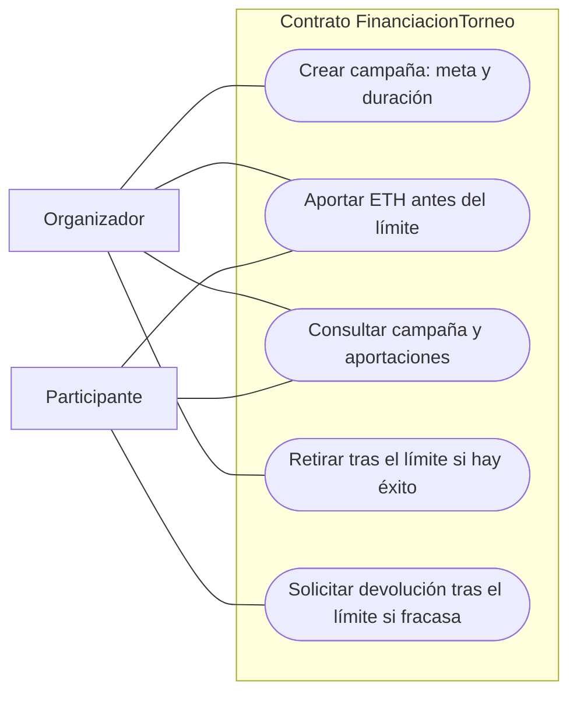

# Casos de uso

El organizador también puede participar y solicitar devolución si aportó a una campaña fallida. Cualquier dirección puede consultar. Cada despliegue crea una campaña independiente. El reloj no es un actor que ejecute pagos: solo condiciona la autorización de las llamadas. La retirada exitosa y las devoluciones por fracaso son mutuamente excluyentes.
