# Práctica 1 - Ejercicio 5: Creación de Smart Contract

**Autor:** Zayan Santos Díaz
**Máster:** Máster Interuniversitario en Ciberseguridad (MUniCS) - Universidade de Vigo / Universidade da Coruña
**Asignatura:** Tecnologías de Registro Distribuido y Blockchain (BC)

Esta memoria documenta la resolución del Ejercicio 5, detallando el ciclo completo de creación de un contrato inteligente en Solidity, desde su diseño hasta su despliegue y pruebas exhaustivas en Remix IDE.

---

## (1) Análisis y definición del escenario

El escenario elegido es una plataforma de **Financiación de Torneos (Crowdfunding)**.
Para organizar un torneo (como puede ser de eSports o cualquier evento deportivo), se requiere recaudar una cantidad específica de fondos (objetivo) dentro de un periodo de tiempo determinado. 

Se necesita la funcionalidad proporcionada por una blockchain pública como Ethereum para:
* **Transparencia:** Todos los patrocinadores/jugadores pueden ver cuánto se ha recaudado, el objetivo final y la fecha límite inmutable.
* **Automatización sin confianza (Trustless):** Garantizar que si no se alcanza el objetivo en el tiempo estipulado, los usuarios puedan recuperar sus fondos de manera autónoma sin depender de la buena fe del organizador. Y si se alcanza, los fondos se liberen al creador automáticamente.

---

## (2) Diseño

### Lógica de Negocio
1. El **Organizador** despliega el contrato inteligente definiendo el objetivo económico y la duración de la campaña de recaudación.
2. Los **Participantes** envían fondos (ETH/Wei) al contrato mientras el plazo esté activo.
3. Si se alcanza la fecha límite y el objetivo se ha cumplido, el Organizador puede retirar la totalidad de los fondos recaudados.
4. Si se alcanza la fecha límite pero **no** se cumple el objetivo, los Participantes pueden reclamar la devolución exacta de lo que aportaron.

### Contenido del Contrato Inteligente
* **Datos (Variables de Estado):**
  * `owner` (address): Dirección del creador/organizador.
  * `objetivo` (uint256): Meta a recaudar.
  * `fechaLimite` (uint256): Timestamp de cuándo finaliza la campaña.
  * `totalRecaudado` (uint256): Acumulador de los fondos aportados.
  * `fondosRetirados` (bool): Estado de seguridad para evitar dobles retiros por parte del owner.
  * `aportaciones` (mapping address => uint256): Registro individualizado de las cantidades aportadas por cada participante.
* **Funciones de Operación:**
  * `aportar()`: Permite a los usuarios enviar valor payable.
  * `retirarFondos()`: Transfiere el balance al organizador en caso de éxito.
  * `reclamarDevolucion()`: Reembolsa al usuario si la campaña fracasó.
* **Reglas y Restricciones (Modificadores):**
  * `soloPropietario`: Restringe operaciones sensibles.
  * Extensivo uso de bloqueos temporales (`block.timestamp < fechaLimite`).

### Usuarios del Sistema (Casos de Uso)
* **Organizador (Owner):** Inicia la campaña, verifica el estado y retira fondos si es exitosa.
* **Participante / Patrocinador:** Envía fondos al contrato, consulta su nivel de aportación y solicita el reembolso si la campaña no cumple la meta.

*(Para diagramas adicionales, consultar el archivo `CASOS_DE_USO.md` adjunto en el proyecto).*

---

## (3) Implementación

El código se ha programado en Solidity (versión `>=0.8.30`), aplicando buenas prácticas y técnicas de optimización de gas:
* **Uso de Eventos:** Se emiten eventos (`AportacionRealizada`, `FondosRetirados`, `DevolucionReclamada`) en las funciones principales para delegar el historial al frontend sin gastar gas almacenando logs en variables de estado.
* **Tipos de datos:** Dimensionamiento y control de variables correcto, aprovechando las devoluciones de gas del operador `revert()` interno de los statements `require()`.
* **Seguridad:** Implementación de protecciones básicas contra re-entrancy reseteando los saldos de los usuarios (`aportaciones[msg.sender] = 0;`) antes de efectuar la transferencia de la devolución.

*(Revisar el código fuente en el directorio `contracts/FinanciacionTorneo.sol`)*.

---

## (4) Pruebas (Entorno Remix IDE)

Se ha simulado exhaustivamente la ejecución en el entorno **Remix VM**. A continuación, se explican las pruebas realizadas, enlazando directamente con las capturas de pantalla obtenidas.

### 4.1 Configuración y Compilación
El contrato fue compilado exitosamente sin *warnings* críticos.
* 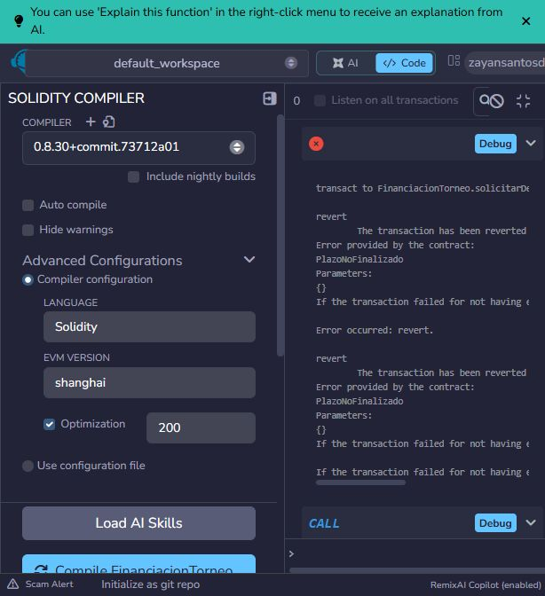
* 

### 4.2 Pruebas de Despliegue (Constructor)
Se validaron las restricciones de inicialización impuestas por los `require` en el despliegue del contrato:
* **Rechazo por parámetro inválido (Objetivo 0):** El contrato revierte la transacción correctamente. 
* **Rechazo por parámetro inválido (Duración 0):** 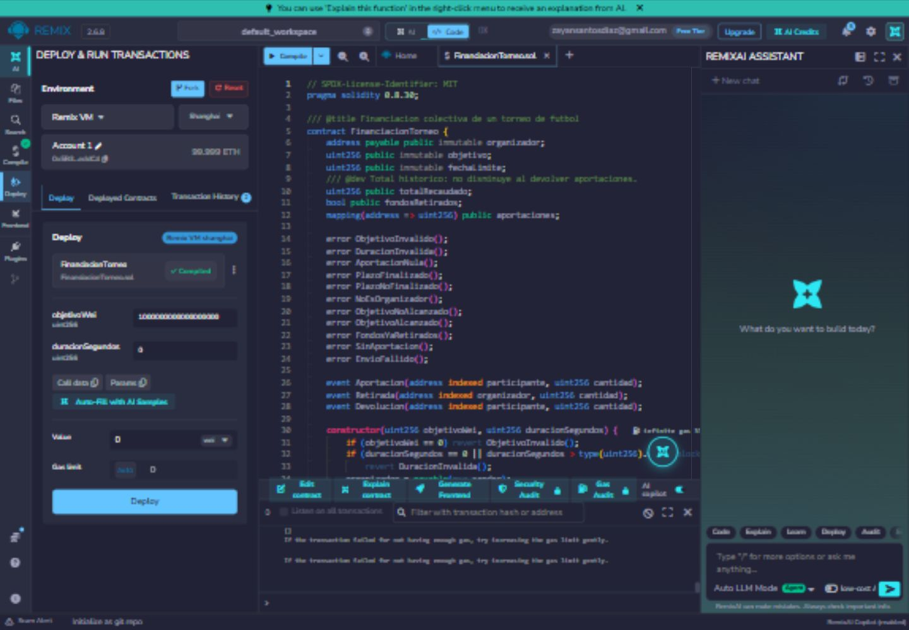
* **Despliegues exitosos:** Con parámetros válidos.  | 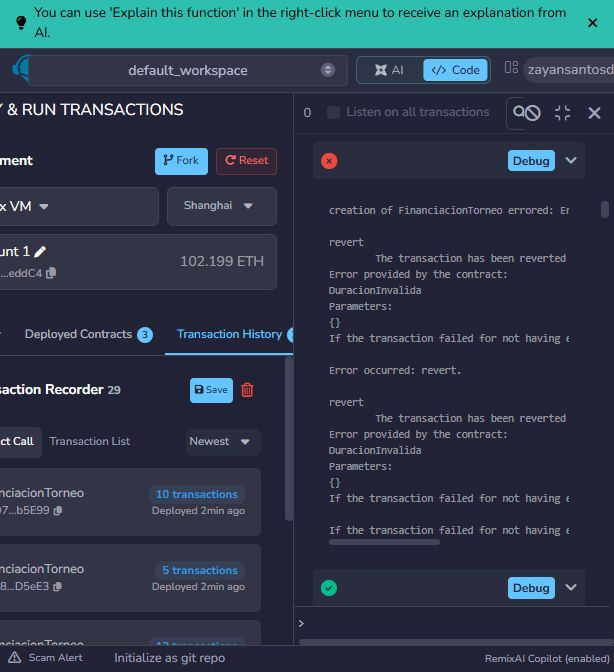

### 4.3 Pruebas de Aportaciones
Comprobaciones del flujo de entrada de fondos de los patrocinadores:
* **Aportaciones exitosas (Casos estándar):** 
* **Aportación denegada (Fuera de plazo):** Bloqueo automático de nuevos ingresos al vencer el timestamp. 
* **Aportación denegada (Valor Cero):** No se permiten transacciones vacías. 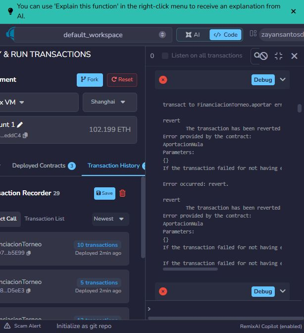
* **Comportamiento en Límites de Objetivo:** Se verificó el registro al llegar al objetivo exacto  y al superarlo con exceso de fondos .

### 4.4 Retirada de Fondos (Organizador)
* **Control de Acceso:** La validación mediante `msg.sender` aísla la función. Solo el creador puede retirar. 
* **Rechazo por retiro prematuro:** Intento de liquidación bloqueado si el tiempo de campaña aún está activo.  y 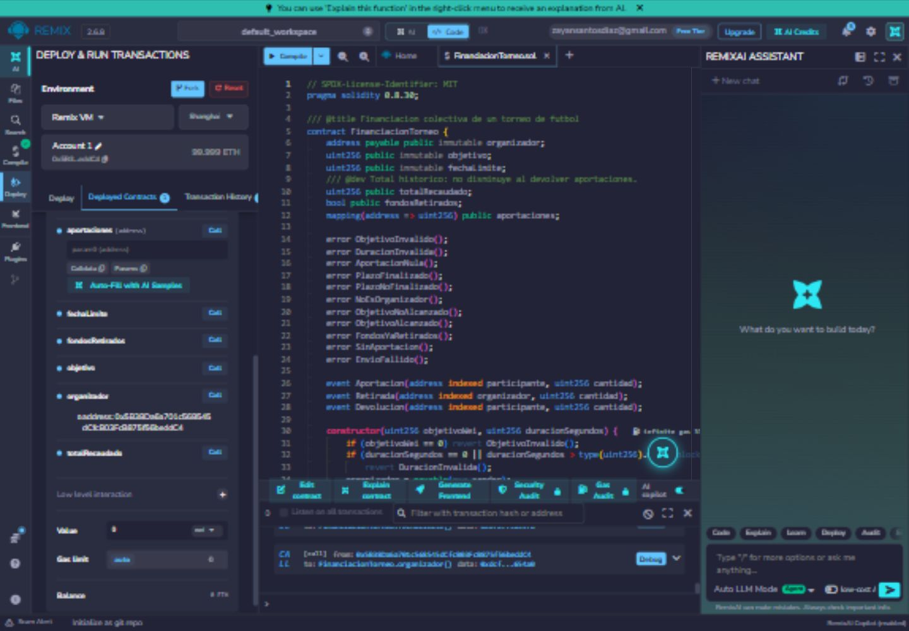.
* **Rechazo por fracaso de recaudación:** Si termina el plazo y no se llegó al objetivo, el owner no puede mover los fondos. .
* **Protección de doble retiro:** Un segundo intento de retiro del owner es denegado correctamente. 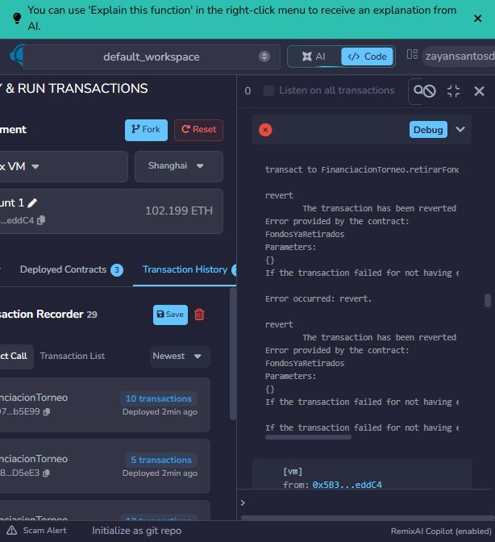.

### 4.5 Reclamación de Devoluciones (Patrocinadores)
Simulación de una campaña que finaliza sin lograr su meta económica:
* **Estado de Campaña Fallida:** Queda constatado que el contrato retiene el saldo intacto. 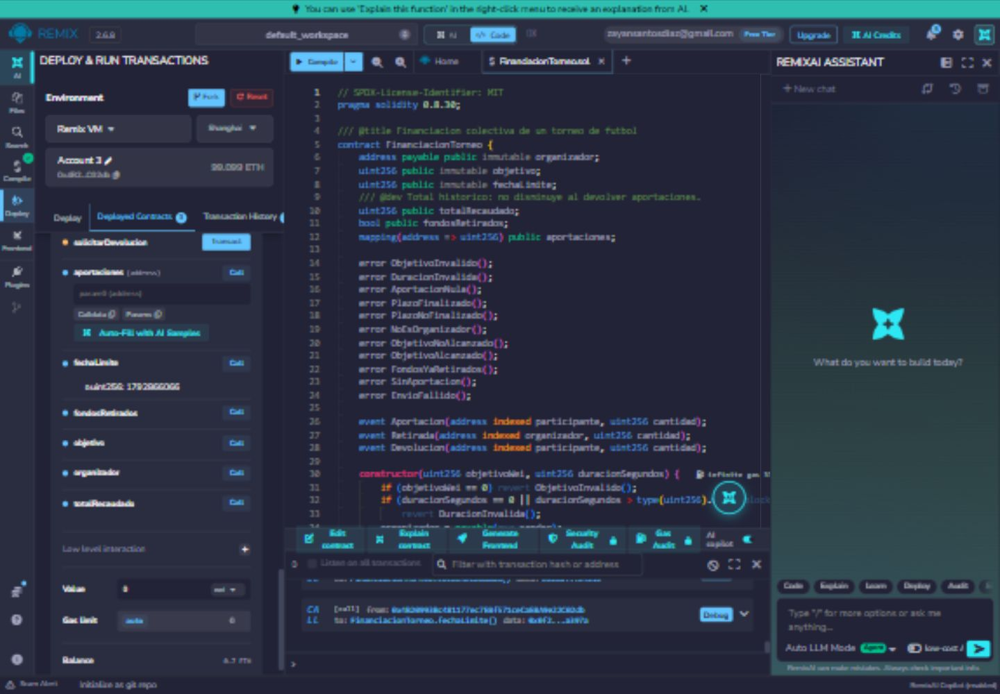.
* **Devolución rechazada (Antes de plazo):** No se puede reclamar el dinero si aún hay tiempo para que la campaña sea un éxito. .
* **Devolución rechazada (Campaña Exitosa):** Si el torneo se logró financiar, los reembolsos quedan bloqueados permanentemente. 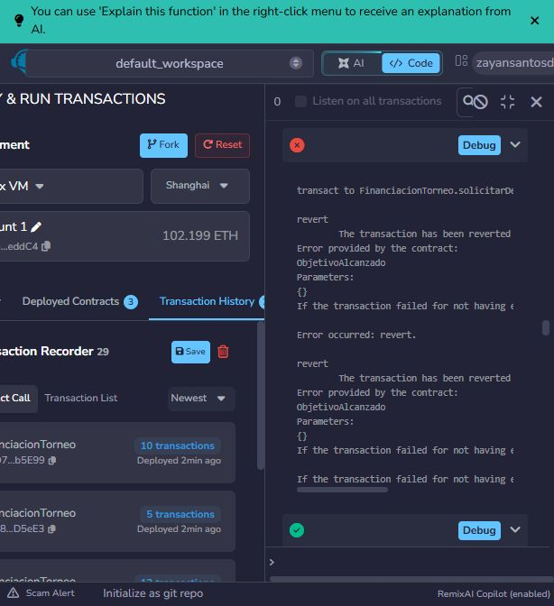.
* **Solicitudes en carteras sin saldo:** Se bloquean transacciones desde *addresses* que no han aportado nada. 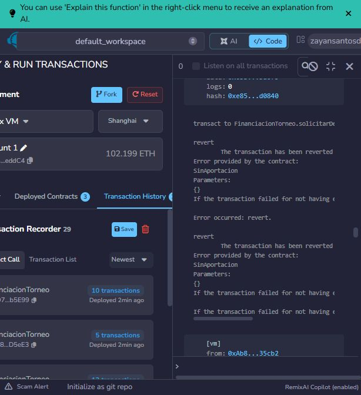.
* **Protección contra doble devolución:** Tras el reembolso exitoso, intentos adicionales del mismo usuario fallan. 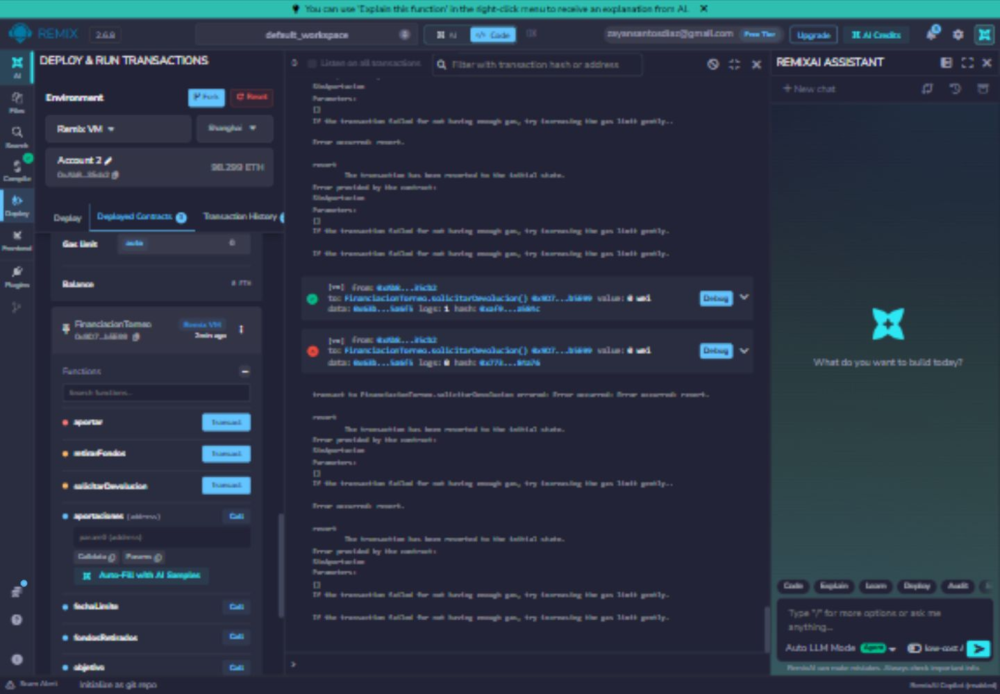 | 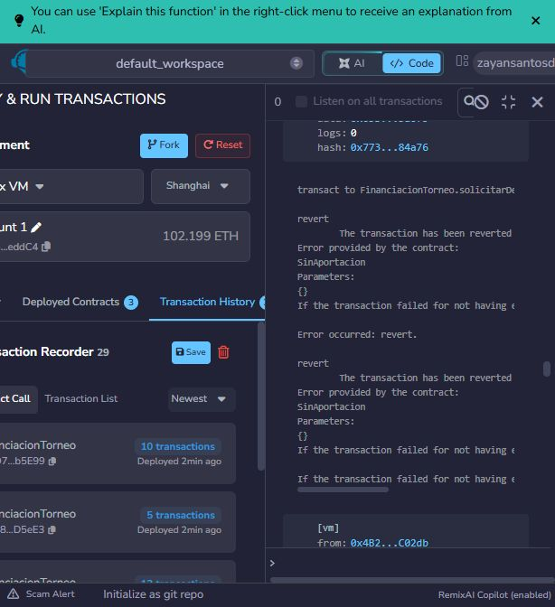.
* **Devoluciones exitosas:** El contrato devuelve los fondos íntegros a las carteras de los participantes. .

### 4.6 Inspección de Estados y Trazabilidad
* **Logs y Eventos:** Correcta emisión de eventos transaccionales con `timestamps` y cantidades. 
* **Estados Finales de Variables:** Comprobación post-ejecución del mapeo de aportaciones y total recaudado. 

*(Para la comprobación técnica de los metadatos de red, consultar los registros extraídos en `evidencias/remix-transacciones.json` y `evidencias/remix-estados-finales.json`)*.
