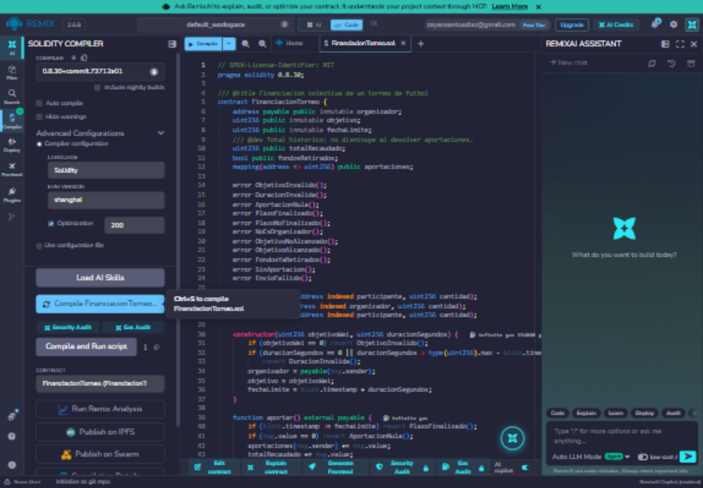
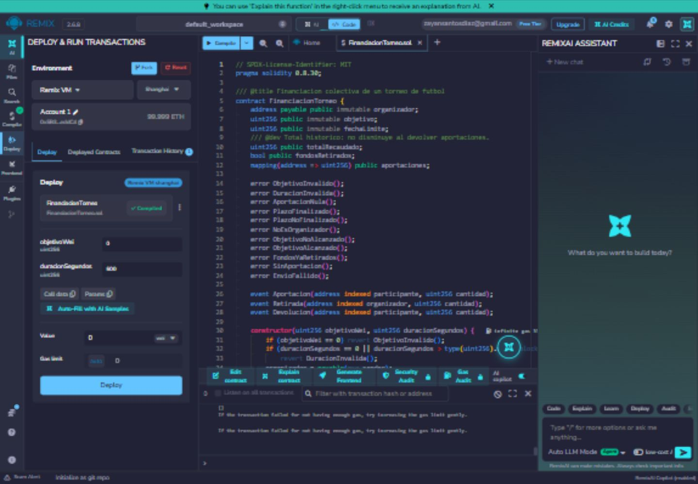
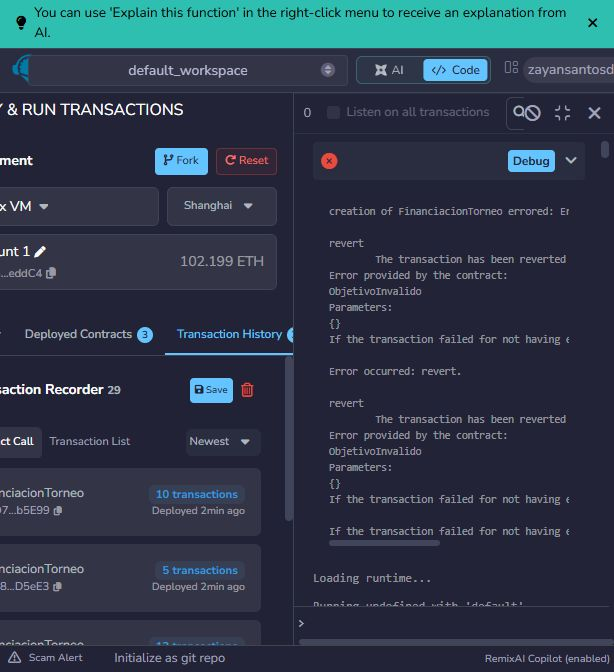
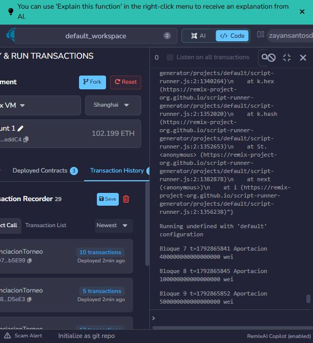
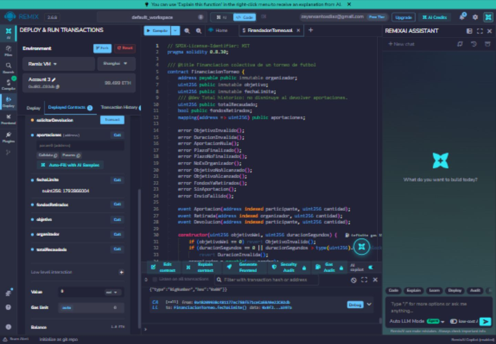
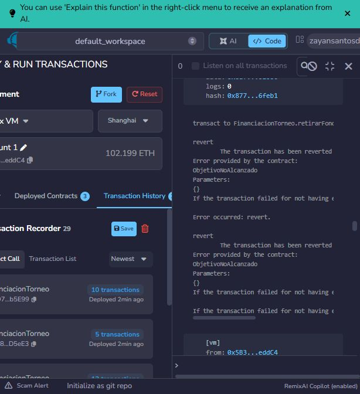
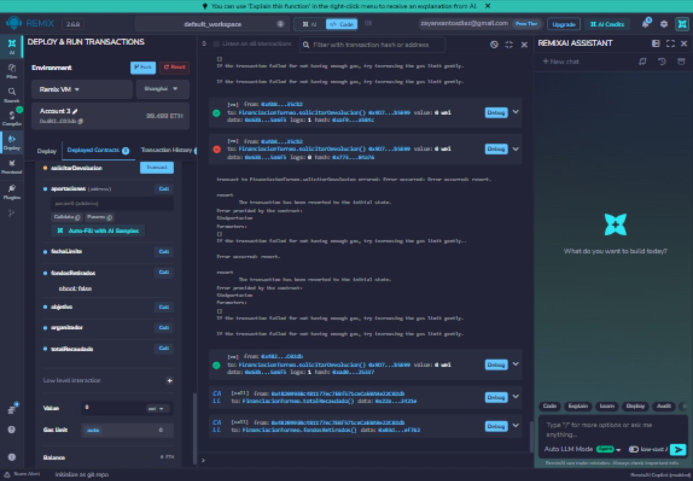
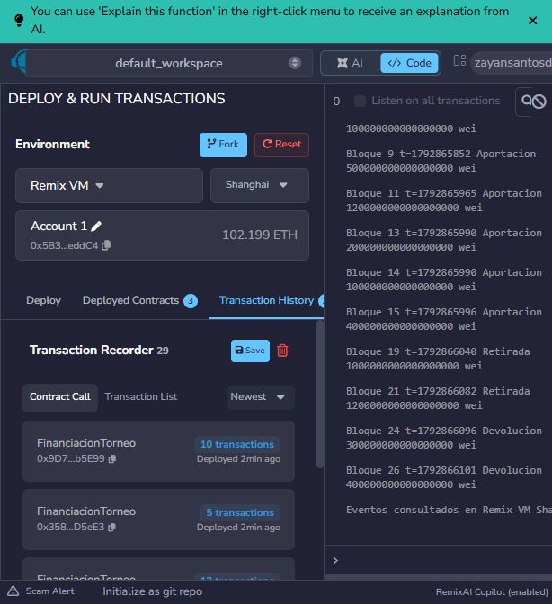
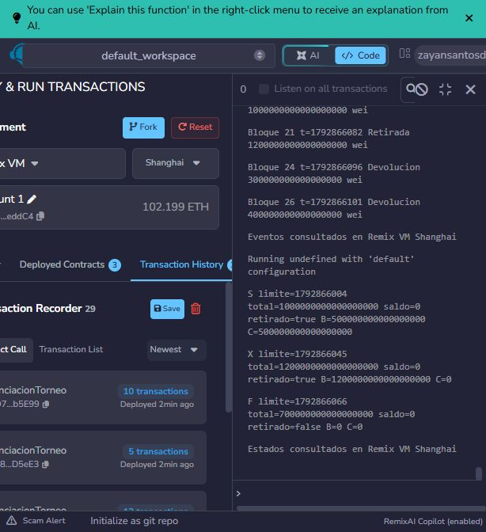

# Práctica 1 - Ejercicio 5: Creación de Smart Contract

**Autor:** Zayan Santos Díaz
**Máster:** Máster Interuniversitario en Ciberseguridad (MUniCS) - Universidade de Vigo / Universidade da Coruña
**Asignatura:** Tecnologías de Registro Distribuido y Blockchain (BC)

Esta memoria documenta la resolución del Ejercicio 5, detallando el ciclo completo de creación de un contrato inteligente en Solidity, desde su diseño hasta su despliegue y pruebas exhaustivas en Remix IDE.

---

## (1) Análisis y definición del escenario

El escenario elegido es una plataforma de **Financiación de Torneos (Crowdfunding)**.
Para organizar un torneo (como puede ser de eSports o cualquier evento deportivo), se requiere recaudar una cantidad específica de fondos (objetivo) dentro de un periodo de tiempo determinado. 

Se necesita la funcionalidad proporcionada por una blockchain pública como Ethereum para:
* **Transparencia:** Todos los patrocinadores/jugadores pueden ver cuánto se ha recaudado, el objetivo final y la fecha límite inmutable.
* **Automatización sin confianza (Trustless):** Garantizar que si no se alcanza el objetivo en el tiempo estipulado, los usuarios puedan recuperar sus fondos de manera autónoma sin depender de la buena fe del organizador. Y si se alcanza, los fondos se liberen al creador automáticamente.

---

## (2) Diseño

### Lógica de Negocio
1. El **Organizador** despliega el contrato inteligente definiendo el objetivo económico y la duración de la campaña de recaudación.
2. Los **Participantes** envían fondos (ETH/Wei) al contrato mientras el plazo esté activo.
3. Si se alcanza la fecha límite y el objetivo se ha cumplido, el Organizador puede retirar la totalidad de los fondos recaudados.
4. Si se alcanza la fecha límite pero **no** se cumple el objetivo, los Participantes pueden reclamar la devolución exacta de lo que aportaron.

### Contenido del Contrato Inteligente
* **Datos (Variables de Estado):**
  * `owner` (address): Dirección del creador/organizador.
  * `objetivo` (uint256): Meta a recaudar.
  * `fechaLimite` (uint256): Timestamp de cuándo finaliza la campaña.
  * `totalRecaudado` (uint256): Acumulador de los fondos aportados.
  * `fondosRetirados` (bool): Estado de seguridad para evitar dobles retiros por parte del owner.
  * `aportaciones` (mapping address => uint256): Registro individualizado de las cantidades aportadas por cada participante.
* **Funciones de Operación:**
  * `aportar()`: Permite a los usuarios enviar valor payable.
  * `retirarFondos()`: Transfiere el balance al organizador en caso de éxito.
  * `reclamarDevolucion()`: Reembolsa al usuario si la campaña fracasó.
* **Reglas y Restricciones (Modificadores):**
  * `soloPropietario`: Restringe operaciones sensibles.
  * Extensivo uso de bloqueos temporales (`block.timestamp < fechaLimite`).

### Usuarios del Sistema (Casos de Uso)
* **Organizador (Owner):** Inicia la campaña, verifica el estado y retira fondos si es exitosa.
* **Participante / Patrocinador:** Envía fondos al contrato, consulta su nivel de aportación y solicita el reembolso si la campaña no cumple la meta.

---

## (3) Implementación

El código se ha programado en Solidity (versión `>=0.8.30`), aplicando buenas prácticas y técnicas de optimización de gas:
* **Uso de Eventos:** Se emiten eventos (`AportacionRealizada`, `FondosRetirados`, `DevolucionReclamada`) en las funciones principales para delegar el historial al frontend sin gastar gas almacenando logs en variables de estado.
* **Tipos de datos:** Dimensionamiento y control de variables correcto, aprovechando las devoluciones de gas del operador `revert()` interno de los statements `require()`.
* **Seguridad:** Implementación de protecciones básicas contra re-entrancy reseteando los saldos de los usuarios (`aportaciones[msg.sender] = 0;`) antes de efectuar la transferencia de la devolución.

*(Revisar el código fuente en el directorio `contracts/FinanciacionTorneo.sol`)*.

---

## (4) Pruebas (Entorno Remix IDE)

Se ha simulado exhaustivamente la ejecución en el entorno **Remix VM**. A continuación, se explican las pruebas clave realizadas para validar la seguridad y la lógica del contrato.

### 4.1 Compilación, Despliegue y Rechazos Iniciales
Se validó la sintaxis correcta del contrato y la robustez del constructor. No es posible desplegarlo con parámetros inconsistentes, como una meta económica nula:
* 
* 
* 

### 4.2 Restricciones de Tiempo en Aportaciones
Se verificó el correcto funcionamiento del modificador de tiempo para asegurar que los usuarios (patrocinadores) puedan enviar dinero y el contrato bloquee depósitos tardíos:
* 
* 
* 

### 4.3 Control de Acceso y Lógica de Fracaso (Retirada)
El retiro de fondos funciona y está protegido para el organizador, pero si la campaña finaliza y no se alcanza el objetivo mínimo, el creador no puede acceder a esos fondos, forzando la política de reembolsos:
* 
* 

### 4.4 Devoluciones a Usuarios
Cuando la campaña no prospera, los usuarios pueden recuperar exactamente lo invertido. Se comprobó la ejecución del reembolso devolviendo el saldo al participante:
* 

### 4.5 Inspección de Estados y Trazabilidad
Se comprobó la trazabilidad final revisando los eventos en cadena (Logs) y los estados finales del mapeo de aportaciones tras finalizar el ciclo de vida del contrato:
* 
* 
